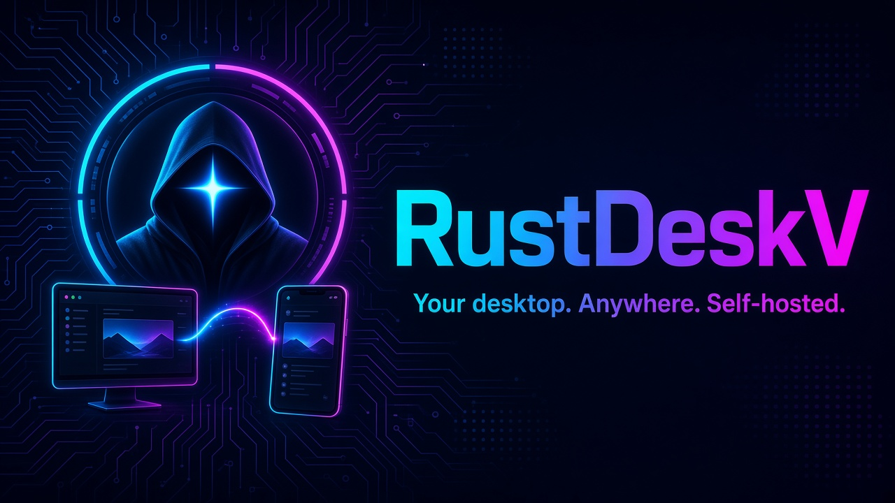

<p align="center">
  <br>
  <a href="docs/MANUAL.md">Manual</a> •
  <a href="#server-settings">Server settings</a> •
  <a href="#raw-steps-to-build">Build</a> •
  <a href="#file-structure">Structure</a> •
  <a href="#credits-and-license">Credits</a>
</p>

# RustDeskV

**Your desktop. Anywhere. Self-hosted.**

RustDeskV is the Victorious fleet's fork of [RustDesk](https://github.com/rustdesk/rustdesk), the open-source remote desktop app written in Rust and Flutter. It is built to run only against **your own** ID/relay server (hbbs/hbbr), for example on your home network or over Headscale/Tailscale.

- **No public servers.** RustDeskV never falls back to RustDesk's public servers. If no server was built in, the app asks you to set one in **Settings > Network**.
- **No upstream update checks.** It does not contact `api.rustdesk.com` for updates.
- **Same signature on every debug build.** Debug APKs are signed with a fixed RustDeskV debug key, so a new build installs over the old one.
- **Plain-English manual.** See [docs/MANUAL.md](docs/MANUAL.md), also available in the app under Settings > About > Help.

> [!Caution]
> **Use responsibly.** Only use RustDeskV on devices you own or are explicitly authorized to access. Unauthorized access, control, or invasion of privacy is illegal in most places and is not supported by this project.

## Server settings

RustDeskV reads its default server at **build time** from these environment variables (in GitHub Actions, from repository secrets of the same names). Anything left unset is empty, never rustdesk.com:

| Variable | What it is | Example |
| --- | --- | --- |
| `RUSTDESKV_RENDEZVOUS_SERVER` | ID / rendezvous server (hbbs) | `100.64.0.10` or `rd.example.com:21116` |
| `RUSTDESKV_RELAY_SERVER` | Relay server (hbbr) | `100.64.0.10:21117` |
| `RUSTDESKV_RS_PUB_KEY` | Server public key (contents of `id_ed25519.pub`) | `AbCd...=` |
| `RUSTDESKV_API_SERVER` | Optional API server URL | `http://100.64.0.10:21114` |

Users can always override these in **Settings > Network > ID/Relay server**. See `src/rustdeskv.rs` for how the defaults are applied.

## Credits and license

RustDeskV is **forked from [RustDesk](https://github.com/rustdesk/rustdesk)** by Purslane Tech Pte. Ltd. and the RustDesk contributors, and is licensed under the **GNU AGPL-3.0**, the same as upstream (see [LICENCE](LICENCE)). All upstream copyright notices are kept. RustDeskV is not affiliated with or endorsed by RustDesk.

The build instructions below are inherited from upstream RustDesk and still apply.

## Dependencies

Desktop versions use Flutter or Sciter (deprecated) for GUI. This tutorial is for Sciter only, since it is easier and more friendly to start. Check out our [CI](https://github.com/rustdesk/rustdesk/blob/master/.github/workflows/flutter-build.yml) for building the Flutter version.

Please download Sciter dynamic library yourself.

[Windows](https://raw.githubusercontent.com/c-smile/sciter-sdk/master/bin.win/x64/sciter.dll) |
[Linux](https://raw.githubusercontent.com/c-smile/sciter-sdk/master/bin.lnx/x64/libsciter-gtk.so) |
[macOS](https://raw.githubusercontent.com/c-smile/sciter-sdk/master/bin.osx/libsciter.dylib)

## Raw Steps to build

- Prepare your Rust development env and C++ build env

- Install [vcpkg](https://github.com/microsoft/vcpkg), and set `VCPKG_ROOT` env variable correctly

  - Windows: vcpkg install libvpx:x64-windows-static libyuv:x64-windows-static opus:x64-windows-static aom:x64-windows-static
  - Linux/macOS: vcpkg install libvpx libyuv opus aom

- run `cargo run`

## Build

Upstream build docs: https://rustdesk.com/docs/en/dev/build/ (reference only).

## How to Build on Linux

### Ubuntu 18 (Debian 10)

```sh
sudo apt install -y zip g++ gcc git curl wget nasm yasm libgtk-3-dev clang libxcb-randr0-dev libxdo-dev \
        libxfixes-dev libxcb-shape0-dev libxcb-xfixes0-dev libasound2-dev libpulse-dev cmake make \
        libclang-dev ninja-build libgstreamer1.0-dev libgstreamer-plugins-base1.0-dev
```

### openSUSE Tumbleweed

```sh
sudo zypper install gcc-c++ git curl wget nasm yasm gcc gtk3-devel clang libxcb-devel libXfixes-devel cmake alsa-lib-devel gstreamer-devel gstreamer-plugins-base-devel xdotool-devel
```

### Fedora 28 (CentOS 8)

```sh
sudo yum -y install gcc-c++ git curl wget nasm yasm gcc gtk3-devel clang libxcb-devel libxdo-devel libXfixes-devel pulseaudio-libs-devel cmake alsa-lib-devel gstreamer1-devel gstreamer1-plugins-base-devel
```

### Arch (Manjaro)

```sh
sudo pacman -Syu --needed unzip git cmake gcc curl wget yasm nasm zip make pkg-config clang gtk3 xdotool libxcb libxfixes alsa-lib pipewire
```

### Install vcpkg

```sh
git clone https://github.com/microsoft/vcpkg
cd vcpkg
git checkout 2023.04.15
cd ..
vcpkg/bootstrap-vcpkg.sh
export VCPKG_ROOT=$HOME/vcpkg
vcpkg/vcpkg install libvpx libyuv opus aom
```

### Fix libvpx (For Fedora)

```sh
cd vcpkg/buildtrees/libvpx/src
cd *
./configure
sed -i 's/CFLAGS+=-I/CFLAGS+=-fPIC -I/g' Makefile
sed -i 's/CXXFLAGS+=-I/CXXFLAGS+=-fPIC -I/g' Makefile
make
cp libvpx.a $HOME/vcpkg/installed/x64-linux/lib/
cd
```

### Build

```sh
curl --proto '=https' --tlsv1.2 -sSf https://sh.rustup.rs | sh
source $HOME/.cargo/env
git clone --recurse-submodules https://github.com/Victorious93/rustdeskV
cd rustdeskV
mkdir -p target/debug
wget https://raw.githubusercontent.com/c-smile/sciter-sdk/master/bin.lnx/x64/libsciter-gtk.so
mv libsciter-gtk.so target/debug
VCPKG_ROOT=$HOME/vcpkg cargo run
```

## How to build with Docker

Begin by cloning the repository and building the Docker container:

```sh
git clone https://github.com/Victorious93/rustdeskV
cd rustdeskV
git submodule update --init --recursive
docker build -t "rustdesk-builder" .
```

Then, each time you need to build the application, run the following command:

```sh
docker run --rm -it -v $PWD:/home/user/rustdesk -v rustdesk-git-cache:/home/user/.cargo/git -v rustdesk-registry-cache:/home/user/.cargo/registry -e PUID="$(id -u)" -e PGID="$(id -g)" rustdesk-builder
```

Note that the first build may take longer before dependencies are cached, subsequent builds will be faster. Additionally, if you need to specify different arguments to the build command, you may do so at the end of the command in the `<OPTIONAL-ARGS>` position. For instance, if you wanted to build an optimized release version, you would run the command above followed by `--release`. The resulting executable will be available in the target folder on your system, and can be run with:

```sh
target/debug/rustdesk
```

Or, if you're running a release executable:

```sh
target/release/rustdesk
```

Please ensure that you run these commands from the root of the RustDesk repository, or the application may not find the required resources. Also note that other cargo subcommands such as `install` or `run` are not currently supported via this method as they would install or run the program inside the container instead of the host.

## File Structure

- **[libs/hbb_common](https://github.com/rustdesk/rustdesk/tree/master/libs/hbb_common)**: video codec, config, tcp/udp wrapper, and some other utility functions shared with the server
- **[libs/base](https://github.com/rustdesk/rustdesk/tree/master/libs/base)**: protobuf, fs functions for file transfer, keyboard and platform code used only by this app
- **[libs/scrap](https://github.com/rustdesk/rustdesk/tree/master/libs/scrap)**: screen capture
- **[libs/enigo](https://github.com/rustdesk/rustdesk/tree/master/libs/enigo)**: platform specific keyboard/mouse control
- **[libs/clipboard](https://github.com/rustdesk/rustdesk/tree/master/libs/clipboard)**: file copy and paste implementation for Windows, Linux, macOS.
- **[src/ui](https://github.com/rustdesk/rustdesk/tree/master/src/ui)**: obsolete Sciter UI (deprecated)
- **[src/server](https://github.com/rustdesk/rustdesk/tree/master/src/server)**: audio/clipboard/input/video services, and network connections
- **[src/client.rs](https://github.com/rustdesk/rustdesk/tree/master/src/client.rs)**: start a peer connection
- **[src/rendezvous_mediator.rs](https://github.com/rustdesk/rustdesk/tree/master/src/rendezvous_mediator.rs)**: Communicate with [rustdesk-server](https://github.com/rustdesk/rustdesk-server), wait for remote direct (TCP hole punching) or relayed connection
- **[src/platform](https://github.com/rustdesk/rustdesk/tree/master/src/platform)**: platform specific code
- **[flutter](https://github.com/rustdesk/rustdesk/tree/master/flutter)**: Flutter code for desktop and mobile

## Screenshots


